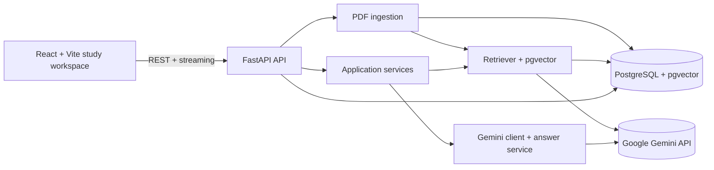

# NoteBot

## A personal AI study assistant for PDF notes

NoteBot is my personal project for exploring grounded generative-AI
applications. It turns PDF study notes into a persistent, searchable study
workspace where I can ask questions, read the source PDF, generate summaries,
create flashcards, and take quizzes.

The application uses Retrieval-Augmented Generation (RAG): the model receives
relevant excerpts from the selected document version instead of being asked to
answer from general knowledge alone. When the notes do not contain enough
evidence, NoteBot is designed to refuse rather than invent an answer.

> **Project status:** personal project / learning project. It is not a
> multi-user production service and should not be used for medical, legal,
> financial, or other high-stakes decisions.

## What NoteBot can do

- Upload text-based PDF notes and index them page by page.
- Keep immutable document versions when the same logical document changes.
- Ask grounded questions with streamed answers and page citations.
- Continue conversations with history persisted in PostgreSQL.
- Generate and save document summaries, flashcard sets, and quizzes.
- Open the exact selected or conversation-pinned PDF beside the study tools.
- Resize or hide the notes sidebar and PDF panel.
- Delete one document or one conversation without clearing unrelated data.
- Restore saved learning assets after restarting the application.

Scanned PDFs without selectable text are currently outside the supported
ingestion path because OCR is not yet included.

## How it works

### 1. Upload and ingestion

The frontend sends a PDF to the FastAPI API. The backend validates the file,
computes a SHA-256 content hash, extracts text with PyMuPDF, preserves page
numbers, and splits the text into overlapping chunks using
`RecursiveCharacterTextSplitter`.

The original PDF bytes, pages, chunks, and metadata are stored in PostgreSQL.
Each chunk is embedded with Gemini Embedding 001 and stored in PostgreSQL
through pgvector.

### 2. Versioned persistence

Documents have two levels:

- A logical document, such as `DBMS_Notes.pdf`.
- One or more immutable document versions containing the exact PDF, pages,
  chunks, and embeddings.

Uploading unchanged content reuses the existing version. Uploading changed
content creates a new version and marks it current without modifying older
versions. A conversation is pinned to one version, so later uploads cannot
silently change the meaning of its history.

### 3. Grounded chat

When a question is submitted:

1. The backend loads the conversation and its pinned document version.
2. Previous messages are used for conversational context and query rewriting.
3. The question is embedded as a retrieval query.
4. pgvector returns candidate chunks from that exact version.
5. Lexical matching and neighboring chunks help direct questions and preserve
   local context.
6. The answer service sends the selected context to Gemini with grounding
   instructions.
7. The response streams to the React client.
8. The completed message and source snapshot are persisted.

The frontend does not choose the retrieval scope or send the full conversation
history. Those decisions are owned by the backend.

### 4. Learning tools

Summary, flashcard, and quiz requests use the same exact document-version
boundary. The backend supplies page-labelled chunk text from that version to
Gemini and validates the structured responses before storing them as generated
assets. Saved items can be reopened later from the sidebar or the relevant tab.

## Architecture



### Main layers

- **Frontend:** `frontend/src/App.jsx` owns workspace state and rendering.
  `frontend/src/api.js` is the browser API client and
  `frontend/src/styles.css` defines the study workspace layout.
- **API:** `app.py` creates the FastAPI application. `app/api.py` exposes
  upload, version, chat, asset, PDF, and deletion endpoints.
- **Ingestion:** `app/ingestion/` validates PDFs, extracts page text, chunks
  content, and prepares documents for persistence.
- **Retrieval:** `app/retrieval/` creates embeddings and performs
  version-scoped pgvector and lexical retrieval.
- **Generation:** `app/generation/` isolates the Gemini client, prompts, and
  grounded answer generation.
- **Services:** `app/services/` contains chat, summary, flashcard, and quiz
  application interfaces.
- **Persistence:** `app/db_models.py`, `app/repositories.py`, Alembic
  migrations, and PostgreSQL manage durable state.
- **Configuration:** `app/config.py` centralizes environment-based settings.

The PDF viewer is intentionally a separate workspace section from Chat,
Summary, Flashcards, and Quiz. It can remain open while switching among the
study tools and closes automatically for Quiz. The notes sidebar and PDF
section have independent open/close and resize controls.

## Tech stack

| Area | Technology |
|---|---|
| Frontend | React 18, Vite, Lucide React |
| Backend | FastAPI, Uvicorn, Pydantic |
| Language | Python, JavaScript/JSX |
| LLM | Google Gemini (configurable; `gemini-3.5-flash-lite` by default) |
| Embeddings | `gemini-embedding-001`, 3072 dimensions by default |
| PDF processing | PyMuPDF |
| Chunking | LangChain text splitters |
| Database | PostgreSQL 16 with pgvector |
| ORM and migrations | SQLAlchemy, Alembic |
| Containers | Docker and Docker Compose |
| Validation | Pytest test suite and frontend Vite production build |

## Project structure

```text
NoteBot/
├── app.py                         # FastAPI application entry point
├── app/
│   ├── api.py                     # HTTP routes and streaming responses
│   ├── config.py                  # Centralized settings
│   ├── database.py                # SQLAlchemy engine and sessions
│   ├── db_models.py               # PostgreSQL persistence models
│   ├── models.py                  # Domain models
│   ├── repositories.py            # Persistence operations
│   ├── schemas.py                 # Structured API/domain schemas
│   ├── ingestion/                 # PDF loading, chunking, pipeline
│   ├── retrieval/                 # Embeddings, pgvector, retrieval
│   ├── generation/                # Gemini client, prompts, answers
│   └── services/                  # Chat and learning services
├── frontend/
│   └── src/                       # React UI, API client, and styles
├── alembic/                       # Database migrations
├── tests/                         # Backend tests
├── evaluation/                    # Evaluation questions and experiments
├── docs/                          # Requirements and project design
├── Dockerfile
├── docker-compose.yml
├── TECHNICAL_DOCS.md
└── requirements.txt
```

## Run locally

### Prerequisites

- Python 3.9 or newer
- Node.js and npm
- Docker Desktop (recommended for PostgreSQL)
- A Google Gemini API key

### Environment configuration

```bash
cp .env.example .env
```

Set `GEMINI_API_KEY` in `.env`. The defaults in `app/config.py` are suitable
for local development. Useful optional settings include:

```dotenv
CHAT_MODEL=gemini-3.5-flash-lite
EMBED_MODEL=gemini-embedding-001
EMBEDDING_DIMENSIONS=3072
CHUNK_SIZE=800
CHUNK_OVERLAP=200
RETRIEVAL_CANDIDATE_K=16
RETRIEVAL_TOP_K=6
RETRIEVAL_SIMILARITY_THRESHOLD=0.35
RETRIEVAL_NEIGHBOR_WINDOW=1
MAX_FILE_SIZE_MB=20
```

### Recommended Docker Compose run

```bash
docker compose up --build
```

Then open:

- Frontend: <http://localhost:5173>
- API health: <http://localhost:8000/api/health>

The PostgreSQL data is stored in the `postgres_data` Docker volume. It
contains document versions, PDF bytes, pages, chunks, embeddings,
conversations, messages, citations, and generated assets.

### Run services separately

```bash
python -m venv venv
source venv/bin/activate
pip install -r requirements.txt

# Start PostgreSQL/pgvector first, then apply migrations.
docker compose up -d db
alembic upgrade head
uvicorn app:app --reload
```

In another terminal:

```bash
cd frontend
npm install
npm run dev
```

## Important API routes

All routes are prefixed with `/api`.

| Method | Route | Purpose |
|---|---|---|
| `GET` | `/health` | Service health check |
| `POST` | `/documents` | Upload and index a PDF |
| `GET` | `/documents` | List logical document versions |
| `GET` | `/documents/{id}/versions` | List versions of a document |
| `GET` | `/document-versions/{id}/file` | Stream the exact PDF version |
| `DELETE` | `/documents/{id}` | Delete a logical document and related data |
| `POST` | `/conversations` | Create a version-pinned conversation |
| `GET` | `/conversations` | List saved conversations |
| `GET` | `/conversations/{id}` | Restore messages and citations |
| `DELETE` | `/conversations/{id}` | Delete one conversation |
| `POST` | `/conversations/{id}/messages` | Stream a grounded chat response |
| `POST` | `/documents/{id}/chat` | Compatibility chat route for a version-aware request |
| `POST` | `/documents/{id}/summary` | Generate and save a structured summary |
| `POST` | `/documents/{id}/flashcards` | Generate and save flashcards |
| `POST` | `/documents/{id}/quiz` | Generate and save a quiz |
| `POST` | `/documents/{id}/quiz/score` | Score submitted quiz answers |
| `GET` | `/documents/{id}/assets` | List saved summaries, cards, and quizzes |

## Testing and validation

Backend tests are under `tests/`. The frontend can be built with:

```bash
cd frontend
npm run build
```

For a complete local stack check:

```bash
docker compose up --build
curl http://localhost:8000/api/health
```

## Documentation

- [`TECHNICAL_DOCS.md`](TECHNICAL_DOCS.md) — detailed architecture, RAG
  pipeline, persistence model, API behavior, and design decisions.
- [`docs/requirements-and-design.md`](docs/requirements-and-design.md) —
  requirements, scope, use cases, architecture, schema, and evaluation plan.
- [`NoteBot_Interview_QA.md`](NoteBot_Interview_QA.md) — project discussion
  and interview preparation notes.

## License and usage

This is a personal project for learning and experimentation. There is no
formal production support or warranty. Use your own API key, keep `.env`
private, and do not commit secrets.
