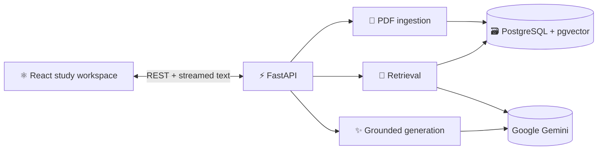

<div align="center">

# ✦ NoteBot

### Your PDF notes, upgraded into a grounded AI study workspace.

[](https://www.python.org/)
[](https://react.dev/)
[](https://fastapi.tiangolo.com/)
[](https://www.postgresql.org/)
[](https://ai.google.dev/)

`React` · `FastAPI` · `Gemini` · `pgvector` · `RAG`

</div>

> A personal project exploring how AI can make study notes more useful—without
> turning them into a black box.

Upload a PDF, open it beside your workspace, and use the same version of your
notes to chat, summarize, revise with flashcards, and test yourself. NoteBot
uses Retrieval-Augmented Generation (RAG), so answers are built from relevant
passages in your document instead of relying only on the model's general
knowledge.

## ✨ What you can do

| | Study mode | What it does |
|---|---|---|
| 💬 | **Grounded chat** | Ask questions and receive streamed answers with page-level sources. |
| 📝 | **PDF reader** | Keep the exact selected or conversation-pinned PDF open while studying. |
| ✨ | **Smart summary** | Turn notes into a structured overview, key topics, and study tips. |
| 🃏 | **Flashcards** | Generate reusable question-and-answer cards with difficulty labels. |
| ✅ | **Quiz mode** | Create mixed question quizzes, submit answers, and score them locally. |
| 🕰️ | **Versioned notes** | Upload a revision without rewriting an existing conversation's source material. |

<br />

```text
  📄 Upload a PDF  ──►  ✂️ Extract + chunk  ──►  🧠 Embed + store
                                                        │
                                                        ▼
  💬 Chat  ◄────────  🔎 Retrieve the right passages  ◄─┘
       │
       └──►  📌 Stream answer + page citations
```

## 🧠 The idea behind NoteBot

Generic chatbots can sound confident even when the answer is not in your
material. NoteBot keeps the study session tied to a concrete document version:

- **Evidence first.** It retrieves relevant, page-aware chunks before it asks
  Gemini to answer.
- **Version-safe conversations.** An older chat stays pinned to its original
  PDF version, even if you upload an updated file later.
- **Honest fallback.** If retrieval cannot find enough evidence, it returns a
  clear refusal rather than inventing an answer.
- **Persistent by design.** Documents, embeddings, conversations, citations,
  and generated study assets survive restarts in PostgreSQL.

## 🏗️ Architecture



<details>
<summary><b>See the flow in detail</b></summary>

### 1. Index the notes

The API validates the PDF, hashes it with SHA-256, extracts page text with
PyMuPDF, and splits it into overlapping, page-aware chunks. Each chunk receives
a Gemini embedding and is stored in PostgreSQL through pgvector.

### 2. Preserve the context

NoteBot separates a logical document from its immutable versions. Identical
uploads reuse the existing version. Changed content becomes a new current
version, while existing conversations keep their original scope.

### 3. Answer with sources

For a question, NoteBot loads the conversation history, rewrites follow-ups
when needed, retrieves version-scoped candidates, enriches results with lexical
matches and nearby chunks, then streams a grounded Gemini response. The answer
and its source snapshot are saved when the stream completes.

### 4. Build study material

Summary, flashcard, and quiz requests use page-labelled text from the selected
version. Their structured payloads are validated before being saved as reusable
learning assets.

</details>

## 🧰 Stack

| Layer | Tools |
|---|---|
| **Frontend** | React 18, Vite, Lucide React |
| **Backend** | Python, FastAPI, Uvicorn, Pydantic |
| **AI** | Google Gemini, `gemini-embedding-001` |
| **Search** | pgvector cosine search, lexical matching, neighbor expansion |
| **Document processing** | PyMuPDF, LangChain text splitters |
| **Persistence** | PostgreSQL 16, SQLAlchemy, Alembic |
| **Local development** | Docker, Docker Compose, Pytest |

## 🚀 Get running

### The quick route

```bash
git clone https://github.com/atharv-lalage/NoteBot.git
cd NoteBot
cp .env.example .env
# Add your GEMINI_API_KEY to .env
docker compose up --build
```

Open the workspace at [localhost:5173](http://localhost:5173), then upload a
text-based PDF and start studying. API health is available at
[localhost:8000/api/health](http://localhost:8000/api/health).

### Running without the full stack

```bash
python -m venv venv
source venv/bin/activate
pip install -r requirements.txt

docker compose up -d db
alembic upgrade head
uvicorn app:app --reload
```

In a second terminal:

```bash
cd frontend
npm install
npm run dev
```

### Configuration

Start with the supplied `.env.example`. The most useful tuning knobs are:

```dotenv
GEMINI_API_KEY=your_api_key_here
CHAT_MODEL=gemini-3.5-flash-lite
EMBED_MODEL=gemini-embedding-001
CHUNK_SIZE=800
CHUNK_OVERLAP=200
RETRIEVAL_CANDIDATE_K=16
RETRIEVAL_TOP_K=6
RETRIEVAL_SIMILARITY_THRESHOLD=0.35
RETRIEVAL_NEIGHBOR_WINDOW=1
```

## 🗂️ Project map

```text
NoteBot/
├── app/
│   ├── api.py              # Routes, validation, streaming responses
│   ├── ingestion/          # PDF loading and chunking
│   ├── retrieval/          # Embeddings, pgvector, ranking
│   ├── generation/         # Gemini client, prompts, answer service
│   └── services/           # Summary, flashcard, and quiz use cases
├── frontend/src/           # React workspace, API client, styling
├── alembic/                # PostgreSQL schema migrations
├── tests/                  # Backend test suite
├── evaluation/             # Question set and chunking experiments
├── TECHNICAL_DOCS.md       # Full technical reference
└── docs/                   # Requirements and design notes
```

## 🔌 API at a glance

All routes begin with `/api`.

| Action | Route |
|---|---|
| Upload a PDF | `POST /documents` |
| Browse documents and versions | `GET /documents`, `GET /documents/{id}/versions` |
| Open an exact PDF version | `GET /document-versions/{id}/file` |
| Start or restore a chat | `POST /conversations`, `GET /conversations/{id}` |
| Stream a response | `POST /conversations/{id}/messages` |
| Create study assets | `POST /documents/{id}/summary`, `/flashcards`, `/quiz` |
| Score a quiz | `POST /documents/{id}/quiz/score` |

## 🧪 Verify it

```bash
./venv/bin/pytest -q

cd frontend
npm run build
```

## 📚 More detail

- [Technical documentation](TECHNICAL_DOCS.md) — architecture, RAG pipeline,
  persistence model, API behavior, and design decisions.
- [Requirements and design](docs/requirements-and-design.md) — scope,
  requirements, data model, and evaluation plan.
- [Interview Q&A](NoteBot_Interview_QA.md) — project discussion notes.

## ⚠️ Project scope

NoteBot is a personal learning project—not a multi-user production service.
OCR, authentication, sharing, and production monitoring are intentionally out
of scope today. Keep API keys in `.env`, never commit secrets, and verify any
generated answer against its cited PDF page.

<div align="center">

Built for the very relatable problem of having notes everywhere and time nowhere. 📚

</div>
