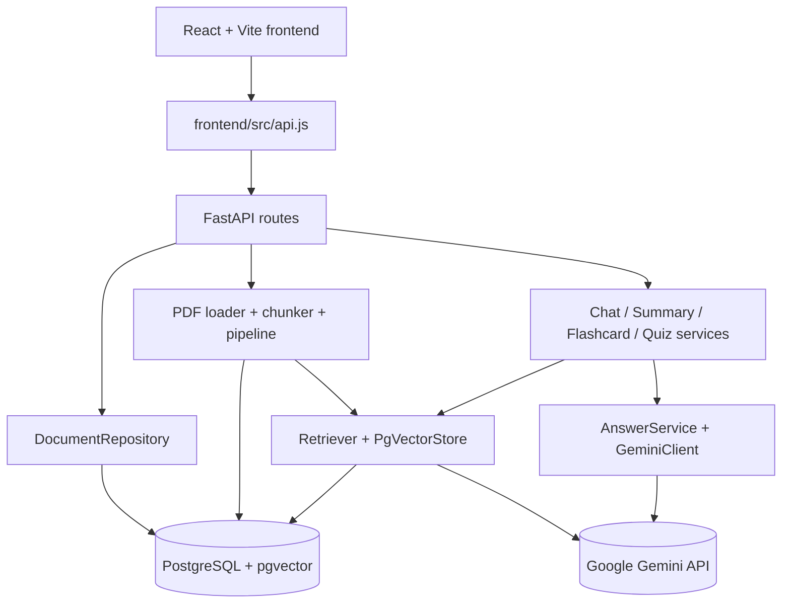
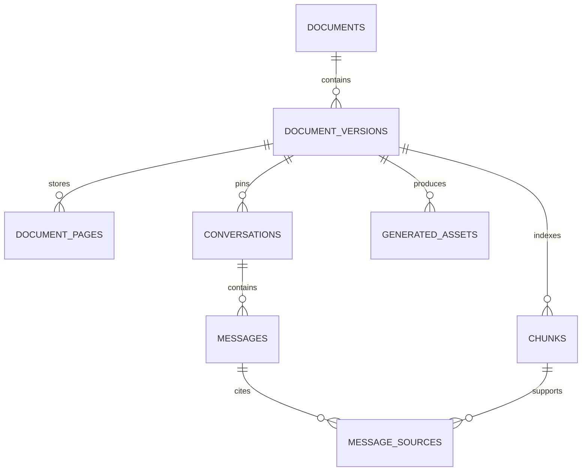

# NoteBot Technical Documentation

This document describes the current implementation of NoteBot, a personal
React/FastAPI study assistant that uses version-scoped Retrieval-Augmented
Generation over uploaded PDF notes.

## Contents

- [System overview](#system-overview)
- [Architecture](#architecture)
- [Ingestion pipeline](#ingestion-pipeline)
- [Retrieval pipeline](#retrieval-pipeline)
- [Generation and grounding](#generation-and-grounding)
- [Persistence and versioning](#persistence-and-versioning)
- [Frontend behavior](#frontend-behavior)
- [API surface](#api-surface)
- [Configuration](#configuration)
- [Reliability and failure handling](#reliability-and-failure-handling)
- [Security and limitations](#security-and-limitations)
- [Design decisions](#design-decisions)

## System overview

NoteBot has four user-facing study modes:

1. **Chat:** streamed question answering grounded in the selected document
   version.
2. **Summary:** structured summary and study guidance.
3. **Flashcards:** persisted question-and-answer cards with difficulty.
4. **Quiz:** persisted structured quizzes with answer submission and scoring.

The PDF reader is a separate section of the workspace. It is not a child of
the Chat component, so the exact PDF can remain visible beside Summary and
Flashcards. Quiz closes the PDF automatically to give the quiz the full study
area.

## Architecture



### Responsibilities by module

| Area | Responsibility |
|---|---|
| `frontend/src/App.jsx` | Workspace state, tab behavior, streaming UI, saved asset restoration, deletion |
| `frontend/src/api.js` | HTTP requests and document/PDF URL construction |
| `app/api.py` | FastAPI routes, request validation, streaming, response mapping |
| `app/ingestion/` | PDF validation, page extraction, chunk creation, status transitions |
| `app/retrieval/` | Gemini embeddings, pgvector search, lexical fallback, neighbor expansion |
| `app/generation/` | Gemini client isolation, prompts, intent classification, answer generation |
| `app/services/` | Use-case orchestration for chat, summaries, flashcards, and quizzes |
| `app/repositories.py` | Transactional persistence and version/conversation operations |
| `app/db_models.py` | SQLAlchemy models and cascade relationships |
| `app/config.py` | Environment-backed settings and retrieval/generation defaults |

## Ingestion pipeline

```text
Upload PDF
  -> validate content type and size
  -> calculate SHA-256 hash
  -> reuse matching version, or create a new immutable version
  -> extract page text with PyMuPDF
  -> reject empty/scanned-only PDFs
  -> split text into page-aware overlapping chunks
  -> persist document, version, PDF bytes, pages, and chunks
  -> batch-embed chunks with Gemini Embedding 001
  -> persist vectors
  -> mark version ready
```

### Document statuses

An upload moves through `uploaded`, `processing`, `ready`, or `failed`
semantics. A failed embedding or persistence step records the error on the
version rather than presenting a false successful result.

### Duplicate and changed uploads

The SHA-256 hash identifies identical file content. Re-uploading an identical
file returns the existing version. If an old matching version predates PDF byte
storage, the upload fills the missing bytes without creating a duplicate
version.

Changed content creates a new version under the logical document. The previous
version remains immutable and queryable by conversations already pinned to it.

## Retrieval pipeline

### Embeddings

Document chunks use `gemini-embedding-001` with a default vector size of 3072.
Query embeddings use the corresponding retrieval-query behavior. Embeddings
are sent in batches to reduce API overhead.

### Search and ranking

For a question, the retriever:

1. Embeds the query.
2. Searches pgvector for `RETRIEVAL_CANDIDATE_K` candidates.
3. Filters by the conversation's exact `document_version_id`.
4. Applies the configured similarity threshold.
5. Uses meaningful lexical terms as a fallback for direct questions where
   semantic ranking alone may under-rank an exact definition.
6. Adds nearby chunks within `RETRIEVAL_NEIGHBOR_WINDOW` while preserving the
   stronger score of the original match.
7. Returns at most `RETRIEVAL_TOP_K` useful results.
8. Deduplicates visible citations by document page.

Default retrieval settings:

| Setting | Default |
|---|---:|
| Chunk size | 800 characters |
| Chunk overlap | 200 characters |
| Candidate count | 16 |
| Returned chunks | 6 |
| Similarity threshold | 0.35 |
| Neighbor window | 1 |

### Version isolation

Retrieval is never performed against all versions of a logical document.
`conversation.document_version_id` is the authoritative scope. This prevents
a follow-up in an old conversation from accidentally using content uploaded
later.

## Generation and grounding

`GeminiClient` is the only module that directly owns Gemini API calls.
`AnswerService` handles intent classification, query rewriting, grounded
prompt construction, streaming, and structured generation used by learning
services.

For grounded questions, the prompt contains:

- the user question,
- relevant conversation history,
- retrieved page-labeled context,
- the pinned document/version identity,
- instructions to answer only from supplied context.

If the context is insufficient, the configured refusal is returned:

> I could not find enough information in your uploaded notes to answer this
> question.

Casual messages can receive a conversational response without forcing an
irrelevant document citation. Normal answers retain structured source
metadata, including document version, page number, chunk ID, and similarity
score.

Chat responses are streamed to the browser. The backend creates a pending
assistant message and marks it completed only after the stream finishes.
Interrupted responses are marked failed rather than being persisted as
successful answers.

## Persistence and versioning

PostgreSQL with pgvector is the durable source of truth. The key entities are:



### Important records

- `documents`: logical document identity and filename.
- `document_versions`: immutable file hash, PDF bytes, status, page count, and
  current-version marker.
- `document_pages`: extracted text with page numbers.
- `chunks`: page-aware content and pgvector embedding.
- `conversations`: persisted history pinned to one version.
- `messages`: user/assistant content and pending/completed/failed status.
- `message_sources`: source snapshots for reproducible citations.
- `generated_assets`: summaries, flashcard sets, and quizzes tied to a
  document version.

Deleting a logical document cascades through its versions, pages, chunks,
conversations, messages, sources, and generated assets. Deleting a
conversation only removes that conversation and its messages/sources. The
sidebar exposes both operations individually and leaves unrelated items
intact.

Alembic migrations currently include the split from legacy documents,
conversation message statuses, removal of obsolete document columns, and PDF
byte storage. Apply the current schema with:

```bash
alembic upgrade head
```

## Frontend behavior

The study workspace consists of:

- a collapsible **Notes** sidebar with document versions, saved assets, and
  conversation history;
- a main **Study workspace** containing Chat, Summary, Flashcards, and Quiz;
- an independent **PDF section** with the exact selected/pinned version.

The sidebar and PDF section have draggable resize handles. Widths are stored
in browser local storage. The UI also stores the selected conversation and tab
so a reload can restore the working context.

When a newer document version exists, an old conversation remains pinned to
its original version. The UI can start a new conversation with the latest
version instead of migrating the old one silently.

Saved summaries, flashcard sets, and quizzes are loaded from the API and can
be selected to restore their original structured payload in the appropriate
tab.

## API surface

All routes are prefixed with `/api`.

### Documents and PDF files

```text
POST   /documents
GET    /documents
GET    /documents/{document_id}/versions
GET    /documents/{document_id}/assets
DELETE /documents/{document_id}
GET    /document-versions/{version_id}/file
```

The PDF endpoint returns stored original bytes. For legacy versions without
stored bytes, it generates a readable preview from persisted page text.

### Conversations and chat

```text
POST   /conversations
GET    /conversations
GET    /conversations/{conversation_id}
DELETE /conversations/{conversation_id}
POST   /conversations/{conversation_id}/messages
POST   /documents/{document_id}/chat
```

The frontend uses the conversation-message route. Its requests contain only a
conversation ID and question:

```json
{
  "conversation_id": "conversation-uuid",
  "question": "Explain normalization"
}
```

The backend loads history and the pinned version. The client does not send
retrieval scopes or fabricate citations. The document chat route is retained
as a compatibility route and performs the same version-pinned flow.

### Learning endpoints

```text
POST /documents/{document_id}/summary
POST /documents/{document_id}/flashcards
POST /documents/{document_id}/quiz
POST /documents/{document_id}/quiz/score
```

The generation endpoints return validated structured payloads and persist
generated assets so the frontend can list and restore them. The scoring route
evaluates a submitted structured quiz locally against its stored answer fields;
it does not invoke the model.

## Configuration

Configuration is centralized in `app/config.py` and loaded from `.env`:

| Variable | Default | Purpose |
|---|---|---|
| `GEMINI_API_KEY` | none | Gemini authentication |
| `CHAT_MODEL` | `gemini-3.5-flash-lite` | Chat/generation model |
| `EMBED_MODEL` | `gemini-embedding-001` | Embedding model |
| `EMBEDDING_DIMENSIONS` | `3072` | pgvector dimension |
| `CHUNK_SIZE` | `800` | Chunk character target |
| `CHUNK_OVERLAP` | `200` | Chunk overlap |
| `MAX_FILE_SIZE_MB` | `20` | Upload limit |
| `MAX_RETRIES` | `3` | Transient Gemini retry limit |
| `DATABASE_URL` | local PostgreSQL URL | Database connection |
| `RETRIEVAL_CANDIDATE_K` | `16` | Initial vector candidates |
| `RETRIEVAL_TOP_K` | `6` | Context result limit |
| `RETRIEVAL_SIMILARITY_THRESHOLD` | `0.35` | Minimum similarity |
| `RETRIEVAL_NEIGHBOR_WINDOW` | `1` | Adjacent chunk range |
| `PROMPT_VERSION` | `v1` | Prompt compatibility marker |

## Reliability and failure handling

- PDF type, size, hash, and extracted-text validation happen before indexing.
- Gemini calls use bounded retry behavior for transient failures such as
  rate-limit and service-unavailable responses.
- API errors are returned explicitly and formatted by the frontend.
- Upload failures mark the affected version failed with an error message.
- Streamed assistant messages are pending until completion.
- Database relationships use cascade deletion for owned version data.
- The frontend avoids replacing live streamed messages with stale hydration
  responses when a new conversation is being created.

## Security and limitations

- API keys belong in `.env`, which is git-ignored; never commit them.
- This personal project has no authentication or multi-user authorization.
- CORS is currently configured for local frontend origins.
- Uploaded data is stored in the configured PostgreSQL database and should be
  treated as local/private development data.
- OCR, user accounts, sharing, permissions, production monitoring, and
  enterprise deployment are not implemented.
- Generated answers remain model output and should be checked against the
  cited PDF pages.

## Design decisions

| Decision | Reason |
|---|---|
| React + FastAPI separation | Keeps UI behavior independent from business logic and model calls |
| Gemini client isolation | Makes generation and API error handling reusable and testable |
| PostgreSQL + pgvector | Preserves documents, embeddings, conversations, and assets across restarts |
| Immutable versions | Keeps old conversations reproducible when files change |
| Exact version retrieval | Prevents cross-version answers and citation drift |
| Page-aware chunks | Makes citations useful and preserves PDF context |
| Stored source snapshots | Keeps historical answers explainable after later uploads |
| Structured learning assets | Allows summaries, cards, and quizzes to be reopened |
| Separate PDF workspace | Lets users read source material beside multiple study modes |
| Per-item deletion | Gives control over individual documents and conversations |
