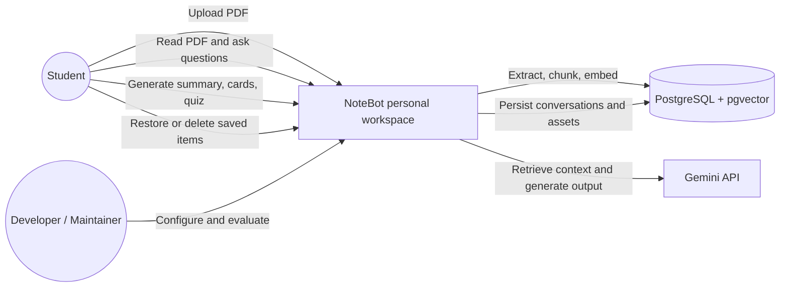
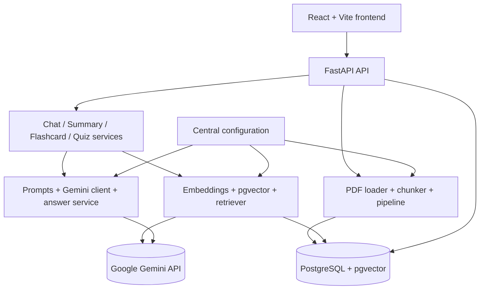
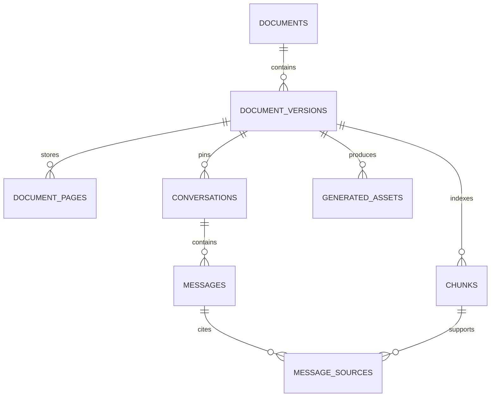

# NoteBot — Requirements and Project Design

## 1. Project identity

**Title:** NoteBot: A Grounded AI Study Assistant for PDF Notes

**Project type:** Personal software project and learning project.

**Problem statement:** Students often have useful course notes in PDFs but
must manually search, summarize, and convert them into study material. Generic
chatbots can answer fluently while inventing information that is not present
in the notes. NoteBot provides one persistent workspace for asking questions,
reading source PDFs, generating summaries, creating flashcards, and taking
quizzes from grounded document context.

**Primary objective:** Build a reliable, easy-to-use study assistant that
turns a PDF into searchable context and produces answers with transparent
source attribution.

**Secondary objectives:**

- Reduce the time needed to locate information in long notes.
- Generate reusable learning material from the same indexed document.
- Keep UI, API, ingestion, retrieval, generation, and persistence concerns
  separated.
- Preserve reproducible conversations when documents change.
- Establish measurable quality and reliability criteria for future iterations.

## 2. Users and scope

### Target users

- **Student:** uploads lecture or revision notes and studies from them.
- **Developer/maintainer:** operates, evaluates, and extends the personal
  project.

### In scope

- Uploading and previewing text-based PDFs.
- Page-aware extraction, chunking, embedding, and persistent indexing.
- Version-pinned grounded chat with streamed answers and citations.
- Structured summaries, flashcards, and quizzes.
- Persistent conversations and generated learning assets.
- Per-document and per-conversation deletion.
- Configuration through environment variables and Docker Compose.

### Out of scope

- Scanned-PDF OCR.
- User accounts, authentication, sharing, and permissions.
- Multi-tenant production hosting.
- Editing generated content in the application.
- Medical, legal, financial, or other high-stakes advice.

### Use-case diagram



## 3. Functional requirements

| ID | Requirement | Acceptance criterion |
|---|---|---|
| FR-01 | Upload a PDF through the React UI. | Valid PDFs start ingestion; invalid, oversized, and empty-text files show actionable errors. |
| FR-02 | Preserve document versions. | Unchanged bytes reuse a version; changed bytes create an immutable version. |
| FR-03 | Extract and chunk text. | Pages retain 1-based numbers and chunks use centralized size/overlap settings. |
| FR-04 | Persist embeddings and source files. | A ready document remains available after an application restart. |
| FR-05 | Ask grounded questions. | Answers use the conversation's exact document version and include source metadata. |
| FR-06 | Stream chat responses. | Partial output is visible before generation completes; failed streams are not marked successful. |
| FR-07 | Persist conversations. | Messages can be restored by selecting a saved conversation. |
| FR-08 | Generate learning assets. | Summaries, flashcards, and quizzes return validated structured data and are saved. |
| FR-09 | Preview the source PDF. | The exact selected or pinned version opens beside the study tools. |
| FR-10 | Delete individual data. | One document or conversation can be deleted without clearing unrelated items. |
| FR-11 | Handle transient API failures. | Retryable Gemini failures use bounded backoff; terminal errors reach the UI. |

## 4. Non-functional requirements

| ID | Requirement | Initial target |
|---|---|---|
| NFR-01 | Grounding | Benchmark questions should be answered with supported context; unsupported questions should receive the configured refusal. |
| NFR-02 | Retrieval quality | Relevant context should appear in the configured top-k results for the evaluation set. |
| NFR-03 | Responsiveness | First streamed chat text should normally appear within 5 seconds on a healthy network. |
| NFR-04 | Reliability | A transient 429/503 is retried up to the configured limit with backoff. |
| NFR-05 | Security | API keys remain in environment variables and are never rendered or committed. |
| NFR-06 | Maintainability | UI modules do not directly implement PDF parsing, vector search, or Gemini client calls. |
| NFR-07 | Portability | The app runs with Docker Compose and with the documented local commands. |
| NFR-08 | Usability | A first-time user can upload a PDF, open the PDF reader, and reach a chat response without code changes. |

## 5. High-level architecture



### Request flows

1. **Indexing:** UI → upload route → PDF pipeline → chunk persistence →
   Gemini embeddings → pgvector → ready version.
2. **Chat:** UI → chat route → persisted conversation → exact-version
   retrieval → grounded answer service → Gemini stream → persisted message.
3. **Learning tools:** UI → summary/flashcard/quiz service → page-labelled
   text from the selected version → validated structured response → generated
   asset. Quiz scoring is performed locally from the structured quiz payload.
4. **PDF preview:** UI → version file route → original stored bytes, or a
   readable legacy preview generated from stored page text.

## 6. Persistence model



The database stores logical documents separately from immutable versions.
Pages, chunks, conversations, citations, and generated assets reference an
exact version. The current schema is managed by Alembic and uses PostgreSQL
with pgvector.

Important entities:

- `documents`: logical document identity.
- `document_versions`: hash, PDF bytes, status, page count, and current marker.
- `document_pages`: extracted page text.
- `chunks`: page-aware content and embedding vector.
- `conversations`: persisted history pinned to a version.
- `messages`: user/assistant content and lifecycle status.
- `message_sources`: source snapshots for reproducible citations.
- `generated_assets`: summaries, flashcards, and quizzes.

Deleting a logical document cascades to its versions and owned data. Deleting
a conversation removes only that conversation and its messages and sources.

## 7. Retrieval and grounding requirements

The default retrieval configuration is:

```env
CHUNK_SIZE=800
CHUNK_OVERLAP=200
RETRIEVAL_CANDIDATE_K=16
RETRIEVAL_TOP_K=6
RETRIEVAL_SIMILARITY_THRESHOLD=0.35
RETRIEVAL_NEIGHBOR_WINDOW=1
```

Retrieval must:

- filter by the conversation's exact `document_version_id`;
- use Gemini Embedding 001 with the configured vector dimension;
- preserve page, chunk, document, and version metadata;
- support lexical fallback for direct definition-style questions;
- add nearby chunks without overwriting stronger original scores;
- return a refusal when no evidence meets the configured threshold.

The current refusal message is:

```text
I could not find enough information in your uploaded notes to answer this question.
```

## 8. Evaluation plan

The executable question set is stored in
[`evaluation/questions.json`](../evaluation/questions.json). It covers:

- direct retrieval;
- multi-part synthesis;
- follow-up questions;
- unsupported questions and refusal behavior;
- summary structure;
- flashcard and quiz generation.

The chunking experiment is in
[`evaluation/chunking_experiment.py`](../evaluation/chunking_experiment.py),
with results in
[`evaluation/chunking_experiment_results.json`](../evaluation/chunking_experiment_results.json).

Future evaluation should measure retrieval recall, citation correctness,
grounded-answer rate, refusal precision, latency, and generated-asset schema
validity on a labeled document/question fixture.

## 9. Dependency decision

The current compatibility baseline retains:

- `google-genai>=1.47.0`
- `langchain-text-splitters>=0.3.11`
- FastAPI, SQLAlchemy, Alembic, pgvector, PyMuPDF, NumPy, and the supporting
  packages listed in [`requirements.txt`](../requirements.txt).

## 10. Current limitations and future work

- Add OCR for scanned PDFs.
- Add authentication and user-specific ownership.
- Add editable generated assets.
- Add richer evaluation datasets and automated retrieval metrics.
- Add production observability, rate limiting, and deployment hardening.
