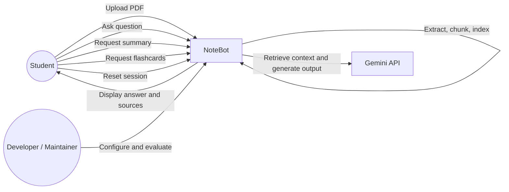
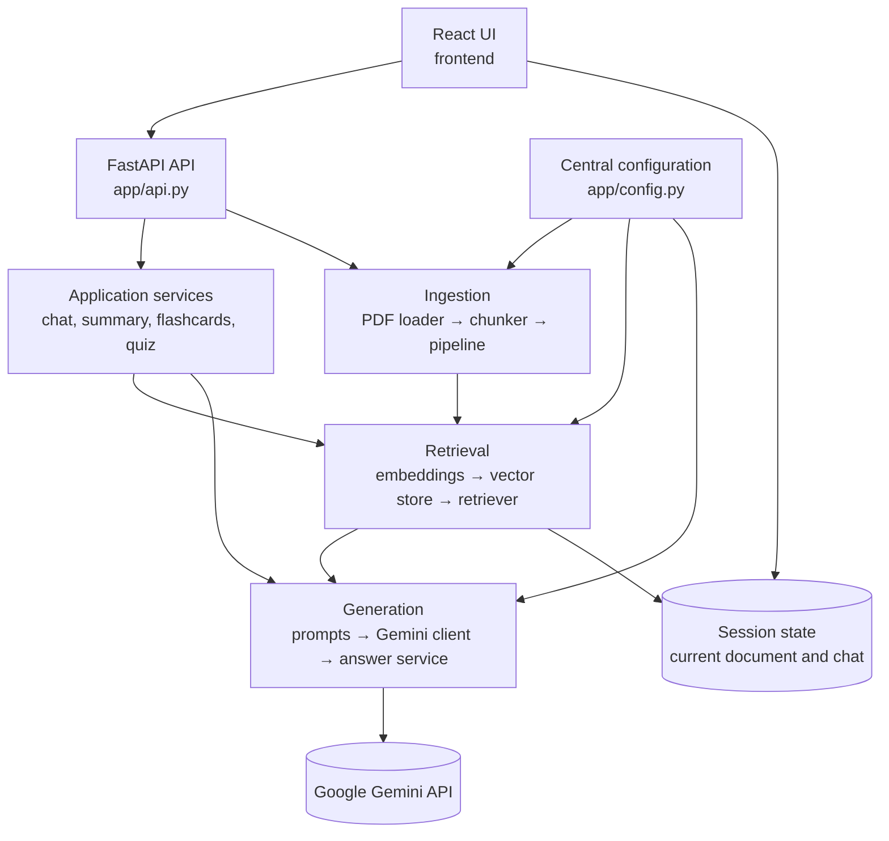
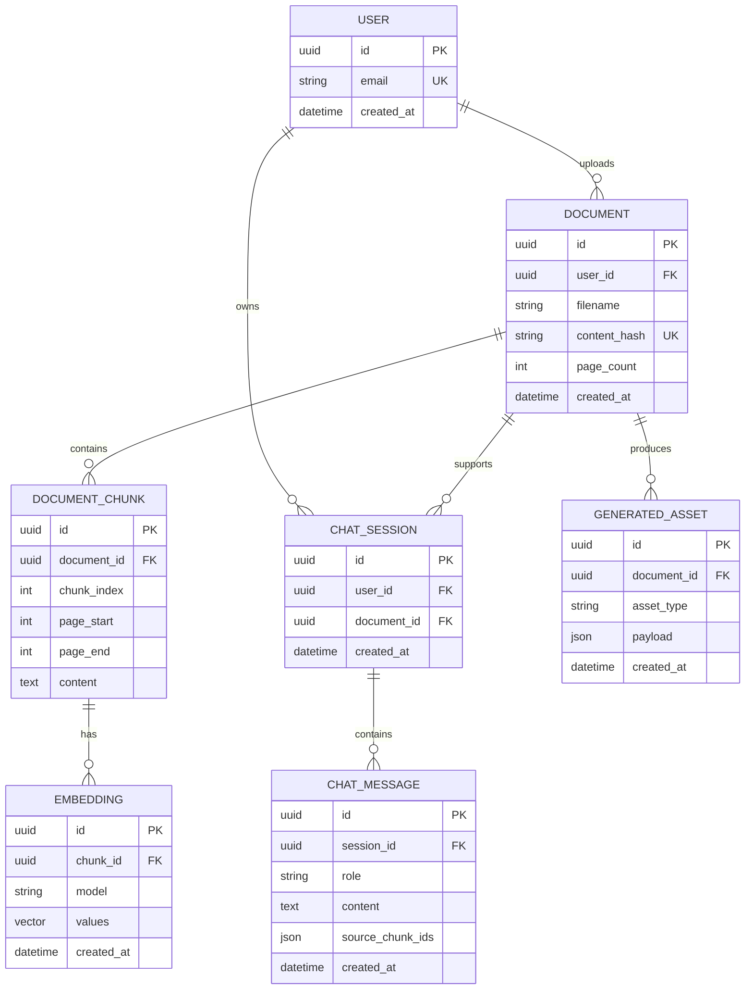

# NoteBot — Week 1 Requirements and Project Design

## 1. Project identity

**Title:** NoteBot: A Grounded AI Study Assistant for PDF Notes

**Problem statement:** Students often have useful course notes in PDFs but must manually search, summarize, and convert them into study material. Generic chatbots can answer fluently but may invent information that is not present in the notes. NoteBot provides a single workspace for asking questions, generating summaries, and creating flashcards grounded in the user's uploaded notes.

**Primary objective:** Build a reliable, easy-to-use study assistant that turns a PDF into searchable context and produces answers with transparent source attribution.

**Secondary objectives:**

- Reduce the time needed to locate information in long notes.
- Generate reusable summaries and flashcards from the same indexed document.
- Keep the UI independent from ingestion, retrieval, generation, and service logic.
- Establish measurable quality and reliability criteria for future iterations.

## 2. Users and use cases

### Target users

- **Student:** uploads lecture or revision notes and studies from them.
- **Educator/content author:** uses generated summaries and cards as a first draft.
- **Developer/maintainer:** operates and evaluates the application.

### In scope

- Uploading a text-based PDF.
- Extracting and chunking document text.
- Embedding chunks and retrieving the most relevant chunks for a question.
- Grounded, streaming chat answers with source snippets.
- Structured summaries and flashcards.
- Configuration through environment variables.

### Out of scope for the initial release

- Scanned-PDF OCR.
- Multi-user accounts, sharing, and permissions.
- Persistent document storage across sessions.
- Editing generated content in the application.
- Medical, legal, or other high-stakes advice.

### Use-case diagram



## 3. Functional requirements

| ID | Requirement | Acceptance criterion |
|---|---|---|
| FR-01 | The user can upload a PDF through the React UI. | A valid PDF starts ingestion; an invalid or empty document shows an actionable error. |
| FR-02 | The system extracts text and splits it into overlapping chunks. | Chunks use centralized size/overlap settings and preserve document order. |
| FR-03 | The system embeds document chunks and stores them for the current session. | A query can be run after successful indexing without re-uploading the file. |
| FR-04 | The user can ask questions about the indexed notes. | The answer is generated from retrieved context and includes source snippets. |
| FR-05 | Chat responses stream into the UI. | Partial output is visible before generation completes. |
| FR-06 | The user can request a structured summary. | Output contains title, summary, key topics, difficulty, and study tips. |
| FR-07 | The user can request a configurable number of flashcards. | Each card contains a question, answer, and difficulty. |
| FR-08 | The user can reset the active session. | Indexed content and chat history are removed without affecting other users. |
| FR-09 | API failures are surfaced and retried according to configuration. | Transient Gemini errors are retried; terminal errors are shown to the user. |

## 4. Non-functional requirements

| ID | Requirement | Initial target |
|---|---|---|
| NFR-01 | Grounding | At least 90% of benchmark questions should be answered with supported context; unsupported questions should receive the configured fallback. |
| NFR-02 | Retrieval quality | Relevant context appears in the top four results for at least 85% of initial evaluation questions. |
| NFR-03 | Responsiveness | The first streamed chat text should normally appear within 5 seconds on a healthy network. |
| NFR-04 | Reliability | A transient 429/503 is retried up to the configured limit with backoff. |
| NFR-05 | Security | API keys remain in environment variables and are never rendered or committed. |
| NFR-06 | Maintainability | UI modules do not directly implement PDF parsing, vector search, or Gemini client calls. |
| NFR-07 | Portability | The app runs locally with `pip install -r requirements.txt` and in the supplied Docker image. |
| NFR-08 | Usability | A first-time user can upload a PDF and reach a chat response without code changes. |

## 5. High-level architecture



### Request flows

1. **Indexing:** UI → ingestion pipeline → embedding service → in-memory vector store → session state.
2. **Chat:** UI → chat service → retriever → answer service → Gemini → UI with sources.
3. **Summary/flashcards:** UI → dedicated service → isolated Gemini client → validated schema → UI.

## 6. Initial database/schema design

The current release uses PostgreSQL/pgvector for persistence. The following relational model is the persistence boundary for documents, users, conversations, and evaluation history.



## 7. Initial evaluation questions

The executable question set is stored in [`evaluation/questions.json`](../evaluation/questions.json). It covers direct retrieval, synthesis, abstention, follow-up context, summaries, and flashcards.

## 8. Dependency decision

The pending dependency change is resolved by retaining the installed and tested compatibility baseline:

- `google-genai>=1.47.0`
- `langchain-text-splitters>=0.3.11`

The remaining dependencies stay unchanged. These versions are compatible with the current refactored modules and the checked-in Python 3.9 environment. Upgrading either package should be a separate, tested dependency task rather than being mixed into Week 1 architecture work.

## 9. Week 1 completion checklist

- [x] Project title, problem statement, users, and objectives defined.
- [x] Functional and non-functional requirements defined.
- [x] High-level architecture and use-case diagrams added.
- [x] Initial persistence schema defined.
- [x] Evaluation questions created.
- [x] Dependency baseline documented in `requirements.txt`.

## 10. Document ingestion lifecycle

PDF uploads follow an explicit lifecycle:

```text
uploaded → processing → ready
                        ↘ failed
```

The ingestion pipeline validates the PDF signature and size before opening it,
computes a SHA-256 content hash, extracts text page by page with PyMuPDF, and
retains 1-based page numbers. A document with no selectable text is reported as
a likely scanned PDF rather than being indexed as empty content. The persistent
document registry rejects duplicate content hashes globally. Each logical
filename is versioned: unchanged bytes return the existing immutable version,
while changed bytes create a new version. A failed processing attempt does not
replace the last ready version.

## 11. Metadata-rich chunks and chunking experiments

Each indexed chunk is represented as a structured object rather than a bare
string:

```json
{
  "id": "document_id-page_4-chunk_2",
  "document_id": "document_id",
  "page_number": 4,
  "chunk_index": 2,
  "content": "…",
  "content_hash": "sha256 content hash"
}
```

Chunk IDs are deterministic for the same document bytes, page, and chunking
configuration. Chunk indices are zero-based within each page. The default
strategy is recursive splitting; heading-aware splitting is also available for
documents with uppercase or Markdown-style headings.
Retrieval results retain the chunk ID and page number for source attribution.

The initial configuration experiment covers all 18 combinations of:

- Chunk sizes: 400, 800, and 1200 characters.
- Overlaps: 50, 100, and 200 characters.
- Strategies: recursive and heading-aware.

The reproducible runner is
[`evaluation/chunking_experiment.py`](../evaluation/chunking_experiment.py),
with baseline results in
[`evaluation/chunking_experiment_results.json`](../evaluation/chunking_experiment_results.json).
The baseline uses a short representative sample and reports chunk count and
character-length ranges; retrieval recall and context precision should be added
when a labeled document/question fixture is available.

## 12. Persistent storage

PostgreSQL with the `pgvector` extension is now the persistence boundary. The
schema is managed by Alembic and includes:

- `users`
- `documents`
- `document_pages`
- `chunks` (including vector embeddings)
- `conversations`
- `messages`
- `message_sources`

Generated summaries and flashcards are also retained in `generated_assets`.
Documents, pages, chunks, and embeddings are saved in one repository operation
after successful indexing. Document versions are append-only: old pages,
chunks, and embeddings are never overwritten. On application startup, the
latest ready document is loaded from PostgreSQL so it remains available after a
restart. New conversations pin the current version, and existing conversations
continue to retrieve from their pinned version. Each assistant message stores source snapshots containing the document, version,
page, chunk, and similarity score. Generated summaries, flashcard sets, and
quizzes also reference the exact `document_version_id`; assets from older
versions remain available after a new upload and are labeled with their source
version. Deleting a document cascades to its pages, chunks, conversations,
source links, and generated assets.

## 13. Production retrieval pipeline

Chat retrieval now follows this sequence:

```text
Question
  → Gemini query embedding
  → pgvector cosine-distance search
  → ready-document and exact document-version filtering
  → candidate over-retrieval (default 16)
  → minimum similarity threshold (default 0.35)
  → neighboring chunks on the same page
  → final top-k context selection (default 6)
  → citation metadata
```

The persistent retriever is implemented in
[`app/retrieval/pgvector_store.py`](../app/retrieval/pgvector_store.py). It
returns chunk IDs, logical document IDs, exact document-version IDs, document
names, version numbers, page numbers, similarity scores, and formatted
version-aware citation strings. Chat retrieval receives one pinned `version_id` and searches
only chunks belonging to that exact document version; logical-document IDs are
never used as a retrieval scope.

Retrieval tuning is centralized through environment variables:

```env
RETRIEVAL_CANDIDATE_K=16
RETRIEVAL_TOP_K=6
RETRIEVAL_SIMILARITY_THRESHOLD=0.35
RETRIEVAL_NEIGHBOR_WINDOW=1
```

## 14. Grounded answer generation

Chat generation uses versioned prompt templates in
[`app/generation/prompts.py`](../app/generation/prompts.py). System instructions
are passed separately from user/document content and explicitly prohibit using
outside knowledge, following instructions embedded in documents, or inventing
citations.

Conversation-aware follow-ups are rewritten into a standalone retrieval query
before vector search. The original question and recent conversation remain in
the answer prompt so the response preserves conversational intent.

If retrieval returns no threshold-qualified evidence, the service returns:

```text
I could not find enough information in your uploaded notes to answer this question.
```

For supported answers, the API returns trusted citation metadata generated from
retrieved chunk metadata:

```text
Source: Operating Systems
Version: 2
Page: 12
```

Generated content is validated for non-empty output and refusal compliance.
The frontend keeps citations outside the answer text in a collapsible source
section, showing the document name, exact version, and page for each source.

## 15. Learning features

The learning tools use Pydantic response contracts in
[`app/schemas.py`](../app/schemas.py), so malformed or incomplete Gemini JSON
is rejected instead of being shown as a successful result.

### Summary

`POST /api/documents/{document_id}/summary` returns:

- `title`
- `summary`
- `key_topics`
- `difficulty` (`beginner`, `intermediate`, or `advanced`)
- `study_tips`

The validated payload is stored as a `summary` generated asset.

### Flashcards

`POST /api/documents/{document_id}/flashcards` returns question-answer cards
with an `easy`, `medium`, or `hard` difficulty and one or more source page
numbers. The validated card set is stored as a `flashcards` generated asset.

### Quizzes

`POST /api/documents/{document_id}/quiz` generates a validated mix of
`multiple_choice` and `short_answer` questions. Each question stores its
correct answer, explanation, difficulty, and source pages. Multiple-choice
answers must be present in their options, while short-answer questions must
not include options.

The generated quiz is stored as a `quiz` asset. The frontend submits the
validated quiz and student answers to
`POST /api/documents/{document_id}/quiz/score`. The server compares
multiple-choice answers exactly and short answers case-insensitively with
collapsed whitespace, returning the number correct, total, percentage, and
the indexes of correct questions.

Run the local database and migrations with:

```bash
docker compose up -d db
alembic upgrade head
```

Or start the complete stack; the application container runs migrations before
launching the FastAPI backend:

```bash
docker compose up --build
```
